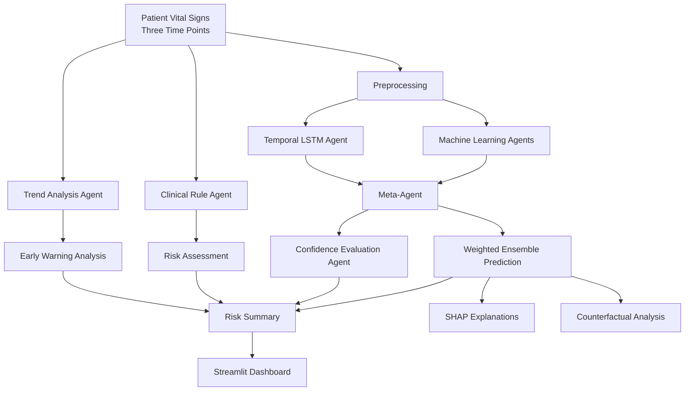

# 🏥 Multi-Agent Early Health Prediction System

An explainable, multi-agent health risk prediction system that combines machine learning, temporal trend analysis, clinical rule-based assessment, and model explainability to identify potential patient deterioration and support early risk monitoring.

> **Disclaimer:** This project is intended for research and educational purposes only. It is not a substitute for professional medical judgment, diagnosis, or treatment.

---

## Table of Contents

- [Overview](#overview)
- [Demo](#demo)
- [Key Features](#key-features)
- [System Architecture](#system-architecture)
- [Technology Stack](#technology-stack)
- [Model Components](#model-components)
- [Input Features](#input-features)
- [Explainability](#explainability)
- [Project Structure](#project-structure)
- [Installation and Setup](#installation-and-setup)
- [Evaluation](#evaluation)
- [Limitations](#limitations)
- [Future Improvements](#future-improvements)
- [Acknowledgements](#acknowledgements)
- [License](#license)

---

## Overview

The system analyzes patient vital signs across three time points to predict health risk levels and identify potentially worsening conditions. It combines multiple predictive models with specialized agents to provide a more comprehensive assessment than a single model alone.

The application is built with **Python and Streamlit**, with interactive visualizations for predictions, agent-level results, trend analysis, and explainability.

---

## Demo


<!-- Add a screenshot or GIF of the dashboard here. -->
 

---

## Key Features

- **Multi-Model Ensemble:** Combines ANN, LSTM, SVM, XGBoost, Random Forest, and Logistic Regression predictions.
- **Early Warning Detection:** Compares static predictions with temporal model outputs and vital-sign trends.
- **Clinical Rule-Based Assessment:** Evaluates vital signs using NEWS2-inspired scoring rules.
- **Trend Analysis:** Analyzes changes in vital signs over three readings to identify potentially deteriorating trends.
- **Confidence Evaluation:** Measures prediction confidence, agreement, and disagreement across model agents.
- **Explainable AI:** Uses SHAP to visualize feature contributions to model predictions.
- **Counterfactual Explanations:** Explores alternative vital-sign combinations associated with a target risk prediction.
- **Interactive Dashboard:** Displays risk summaries, probability distributions, agent predictions, and analytical visualizations.

---

## System Architecture



---

## Technology Stack

| Category | Technologies |
|---|---|
| Language | Python |
| Dashboard | Streamlit |
| Machine Learning | scikit-learn, XGBoost |
| Deep Learning | TensorFlow / Keras |
| Explainable AI | SHAP |
| Data Processing | NumPy, Pandas |
| Visualization | Matplotlib |
| Model Persistence | Joblib, Keras model files |

---

## Model Components

| Component | Responsibility |
|---|---|
| ANN | Predicts risk from current vital signs |
| LSTM | Analyzes sequential vital-sign readings |
| SVM | Provides an additional classification prediction |
| XGBoost | Provides a tree-based classification prediction |
| Random Forest | Provides an ensemble-tree classification prediction |
| Logistic Regression | Provides a linear classification prediction |
| Clinical Rule Agent | Calculates a NEWS2-inspired score |
| Trend Agent | Analyzes direction, velocity, and acceleration of vital-sign changes |
| Confidence Agent | Evaluates confidence and disagreement across predictive agents |
| Meta-Agent | Aggregates model probability outputs using weighted averaging |
| Alert Agent | Combines prediction, clinical score, and trend information to generate alerts |

---

## Input Features

The dashboard accepts the following vital signs at three time points: two hours ago, one hour ago, and the current reading.

| Feature | Description |
|---|---|
| Systolic Blood Pressure | Systolic blood pressure in mmHg |
| Respiratory Rate | Breaths per minute |
| Oxygen Saturation | SpO₂ percentage |
| Heart Rate | Beats per minute |

The model produces one of four risk classifications:

- **Normal**
- **Low**
- **Medium**
- **High**

---

## Explainability

### SHAP Analysis

SHAP visualizations help explore how individual input features contribute to the selected model's prediction. The dashboard provides feature contribution plots and a ranked view of feature impacts.

### Counterfactual Analysis

The system searches for alternative vital-sign combinations that the ANN associates with a target risk class. These alternatives are model-generated explanations, not medically validated treatment recommendations.

---

## Project Structure

```text
HealthRisk_Dashboard/
├── app.py
├── requirements.txt
├── .gitignore
├── README.md
├── models/
│   ├── ann_model.keras
│   ├── lstm_model.keras
│   ├── svm_model.pkl
│   ├── xgb_model.pkl
│   ├── rf_model.pkl
│   ├── lr_model.pkl
│   ├── scaler.pkl
│   ├── scaler_seq.pkl
│   ├── label_encoder.pkl
│   ├── alert_agent.pkl
│   ├── clinical_agent.pkl
│   ├── confidence_agent.pkl
│   └── trend_agent.pkl
├── data/
│   └── X_train.npy
└── Notebooks/
    └── Copy of Multi_Agent.ipynb
```

> *Note: The tree reflects the intended organization. Include only files that exist in your repository, and update the tree if your final folder structure differs.*

---

## Installation and Setup

### 1. Clone the repository

```bash
git clone https://github.com/ShreyaSingh0206/Multi-Agent-Early-Health-Prediction-System.git
cd Multi-Agent-Early-Health-Prediction-System
```

### 2. Create a virtual environment

**Windows:**

```bash
python -m venv .venv
.venv\Scripts\activate
```

**macOS / Linux:**

```bash
python -m venv .venv
source .venv/bin/activate
```

### 3. Install dependencies

```bash
pip install -r requirements.txt
```

### 4. Verify model and data files

Ensure the required trained models are available in `models/` and `X_train.npy` is available in `data/`. The application currently loads these files at startup.

If large model artifacts or datasets are hosted separately, follow the download instructions provided by the repository.

### 5. Run the application

```bash
streamlit run app.py
```

Streamlit will provide a local URL, typically:

```text
http://localhost:8501
```

Open it in your browser to use the dashboard.

---

## Evaluation

The following results were reported during the project's experiments:

| Metric | Reported Result |
|---|---:|
| ANN Test Accuracy | 92.00% |
| Multi-Agent Accuracy | 92.67% |
| Multi-Agent Precision | 93.56% |
| Multi-Agent Recall | 93.57% |
| Multi-Agent F1-Score | 93.52% |

These are experimental results from the project's evaluation. They should not be interpreted as evidence of clinical effectiveness or generalization to real-world patient populations.

---

## Limitations

- Model predictions depend on the training data, preprocessing, and saved model artifacts.
- Performance on external or real-world patient populations has not been established here.
- Confidence scores and ensemble agreement do not guarantee prediction correctness.
- NEWS2-inspired rules in this implementation should not be assumed to constitute a complete, clinically validated NEWS2 assessment.
- Counterfactual outputs are model-based alternatives and should not be used to make treatment decisions.

---

## Future Improvements

- Validate performance on independent datasets.
- Add automated tests and reproducible evaluation scripts.
- Improve handling of missing and out-of-range vital signs.
- Add model monitoring and calibration analysis.
- Explore secure integration with clinical data sources, subject to appropriate privacy and regulatory requirements.

---

## Acknowledgements

Developed as part of research work at **IIT (ISM) Dhanbad**.

---

## License

No license has been specified yet. Add a `LICENSE` file before granting others permission to reuse, modify, or distribute the project.
